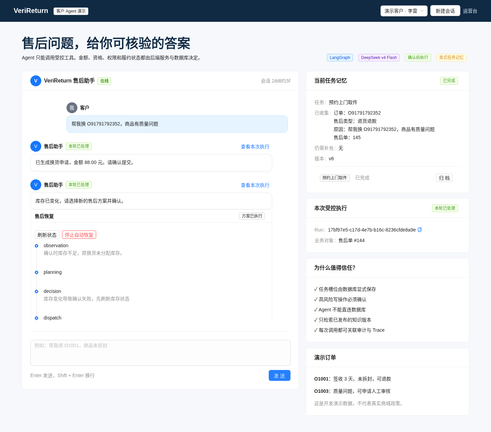
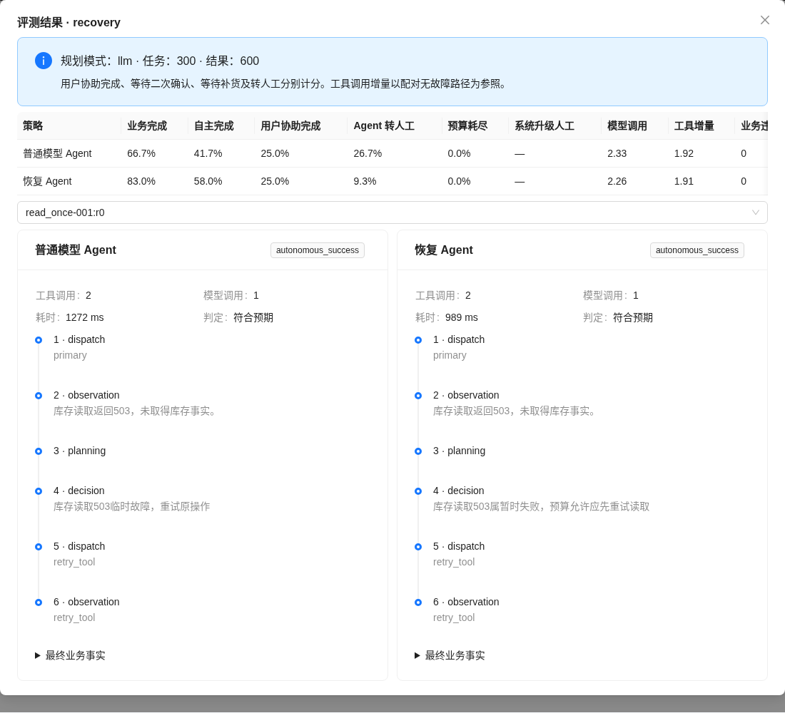

# VeriReturn Recovery 验收与交付

工具注入同时做了两种真实模型的补充验证，见 [记录](recovery-evidence/live-tool-injection.json)；该检查不并入效果统计。

本轮交付的是可接入客户对话的多步恢复模块、领域方案闭环、可断点续跑评测及可复核的真实模型对照。项目实现与模型效果分别验收；模拟支付、开发身份及受控参数化任务的边界保持明确。

## 验收证据

| 验收项 | 结果与证据 |
| --- | --- |
| 全量后端单元/API | 119 passed；PostgreSQL 16 项在此命令跳过，随后独立执行；[日志](recovery-evidence/backend-tests.txt) |
| PostgreSQL 并发与恢复 | 16 passed：重复创建、checkpoint 重建、库存并发、方案重复确认、预算并发/重启、Worker 过期所有权；[日志](recovery-evidence/postgres-tests.txt) |
| 数据库迁移 | 现有数据库升级两条 migration，`alembic check` 无待生成变更；[日志](recovery-evidence/migration-check.txt) |
| 前端生产构建 | TypeScript/Vite build 通过；仍有既有 bundle 大小提示；[日志](recovery-evidence/frontend-build.txt) |
| 真实 API 完整退款 | 库存变化 → 新授权 → 关联退款单 → 取件/退货 → Worker 提交 → 已验签成功回调；退款数量 1/1、金额 88.00，原单取消；[最终事实](recovery-evidence/business-facts.json) |
| 真实 API 完整换货 | 允许替换 SKU → 新确认 → 库存预占 → 出库 → 签收，case completed、exchange delivered；同上 |
| 重复及越权 | 支付回调重放仍为单条渠道事件；他人读取恢复任务返回 404；[演示记录](recovery-evidence/api-demo.json) |
| 浏览器真实交互 | 点击退款方案及再确认、Modal 消失、刷新后方案已执行、原确认警示不返回、任务转为待取件、无横向溢出与 page error；[日志](recovery-evidence/browser-interaction.txt) |
| 主服务重启 | API 重启后恢复记录、确认状态和关联退款事实仍可查询；浏览器刷新测试在重启后的服务执行 |
| 同步接口与分页 | `/ops/recovery/compare` 返回 9 条隔离结果且无 Harness 错误；数据库内策略过滤后分页；[记录](recovery-evidence/synchronous-api.json) |
| 异步评测 | 真实 API 提交的 v3 数据套件完成 900 条离线策略结果；Worker 逐条保存、心跳、租约 fencing，结果分页可读取 |
| 原始结果完整性 | 正式 600、无故障 60、重复 60、离线故障 900、离线无故障 900、专项 94 条结果归档；离线校验工具验证 SHA256 与最终业务事实 |

所有模型规划请求共享持久化 3000 次上限；实际累计见 [预算快照](recovery-evidence/budget.json)。未用新预算键绕过上限，也没有因失败从正式报告中剔除任务。

### 故障与业务边界覆盖

[恢复测试](../backend/tests/test_recovery_v2.py) 验证 12 个变体、客户替换/退款/等待/人工/拒绝/无回复/撤回、过期与陈旧方案、补货重新授权、退款资格、越权、实际渠道提交后崩溃、库存预占后崩溃、支付结算后崩溃、转退款确认后崩溃、非法 JSON/动作、工具内容注入、脱敏与保留期、预算停止及重复恢复。

原有退款、履约和订单行测试同时验证金额/数量约束、回调重放和乱序、预占释放、并发与审计。本轮修复真实验证暴露的 PostgreSQL FK 插入顺序、单商品 Agent 工具序号重复、刷新旧确认警示及关联退款记忆投影问题。

转退款确认后崩溃会沿已提交的新退款单恢复，不创建第二笔退款。恢复继续消耗原规划预算，可能先进入预算停止；独立支付 Worker 仍可完成已授权退款，最终按账本事实判定。系统预算升级工单与模型自主转人工分别计数。

## 实验结果与未夸大的边界

正式 v2 300 条任务：普通模型完整业务完成 200/300，恢复模型 249/300；自主完成 41.67% → 58.00%，客户协助完成两组均为 25%。保留集 40/60 → 50/60；配对提升 16.33 个百分点，95% CI 12.33–20.67。两组均无实际业务违规，恢复策略平均输入 Token 增加约 21.8%，不是免费收益。

收益主要来自读取异常；退款结果未知并未提升（100% 对 99%），库存变化相同（75% 对 75%）。正式结果保留 2 次错误完成判断与 1 次 API 超时。当前代码的 v3 提示仅做 47 条专项验证，未再次完整运行 300 条双策略实验；本轮 300 条正式效果属于冻结 v2，不将其冒充 v3 全量效果。最终专项纠正持续故障环境、补充完成证据提示和预算工单兜底，47 条恢复任务符合预期终态，但其中 16 条由系统预算升级兜底，不宣称模型全部自主解决。

历史规则实验、正式 v2、开发冒烟及 v3 专项分开保存。v3 专项是对已知问题的验证，样本中持续故障比例高，不能替换 v2 效果估计。详情与失败轨迹见 [实验报告](recovery-latest-report.md)。

尚未验证的应用范围：真实支付账户与真实 Provider 网络、线上客户分布、公开基准迁移、完整生产 OIDC 客户端到 Agent 工具身份代理。已有配置边界与受控适配器不等于这些场景已经部署通过。

## 演示顺序

1. 启动 Miniforge 环境、PostgreSQL、API、Worker 与前端；访问 `/agent`。
2. 运行 `python -m scripts.demo_recovery_v2` 创建独立开发订单，展示旧确认库存变化、恢复轨迹和最终退款/换货事实。
3. 运行 `python -m scripts.prepare_recovery_browser`，再运行 `python -m scripts.verify_recovery_browser --exercise-choices`，展示浏览器新方案确认、关闭与刷新恢复。
4. 运行 `python -m scripts.import_recovery_report` 导入已归档的正式 CLI 结果；运营台查看 recovery 明细，选同一任务比较真实普通/恢复模型轨迹、成本及独立判定结果。导入不产生模型调用。
5. 运行 `python -m scripts.verify_recovery_evidence`，离线复核归档哈希、正式计数及最终业务事实；不会再次调用模型。

## 简历描述

**VeriReturn｜可验证电商售后与工具故障恢复 Agent**

Python / FastAPI / LangGraph / PostgreSQL / DeepSeek / React

- 构建订单行级退款、库存换货与人工协同 Agent，以事务、幂等、Outbox/Inbox 和版本化客户确认保证业务执行；任务记忆按领域事实恢复，覆盖结果未知、重复回调和重启续跑。
- 实现多步工具恢复流程与 12 变体、300 任务评测集，通过独立业务状态判定、真实模型对照及逐任务轨迹验证；同模型和业务保护下，业务完成率由 66.67% 提升至 83.00%，配对提升 16.33 个百分点（95% CI：12.33–20.67）。
- 将恢复流程接入客户售后对话，完成替换 SKU / 转退款的再次授权与履约闭环，提供策略对照、调用成本及失败分析；通过 119 项后端和 16 项 PostgreSQL 测试及真实浏览器验收。

面试应强调“哪些决策由模型作出、哪些安全约束由领域保证、为什么某些任务保持开放，以及如何证明业务真正完成”。这是应用与工程能力证据；不应包装为训练新模型、提出新恢复算法或已上线真实支付平台。

仓库：<https://github.com/yfish512/verireturn>
