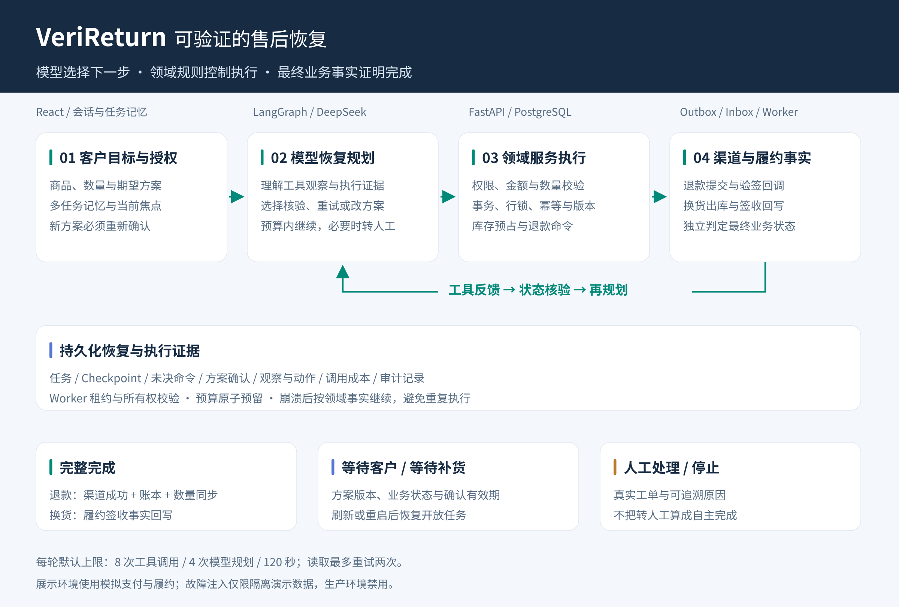
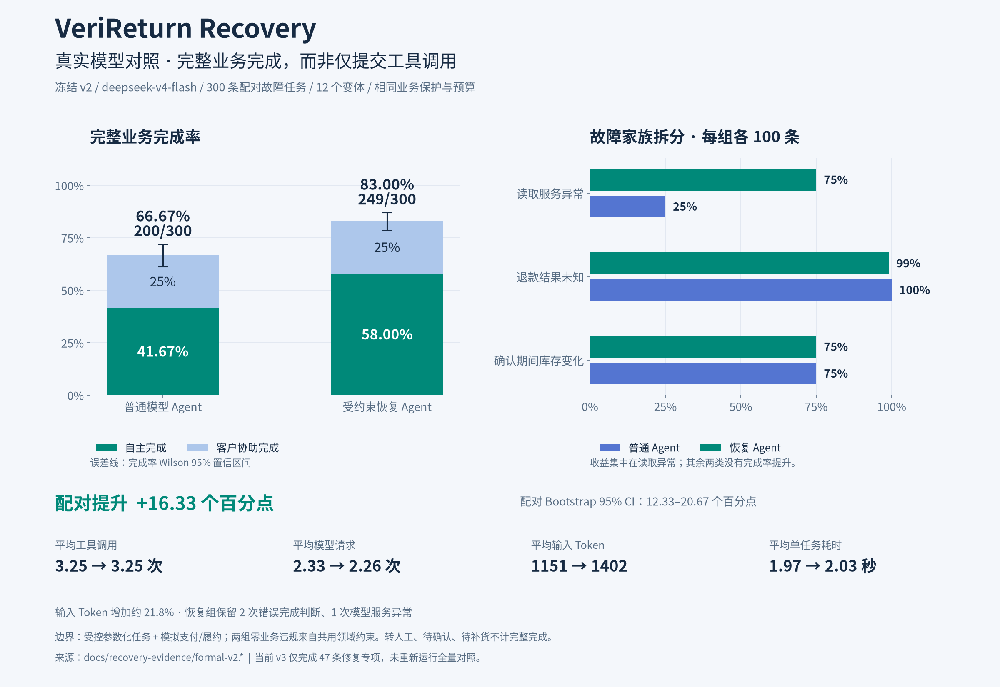

# VeriReturn 成果展示

以下流程图与结果图由代码生成，页面截图来自运行中的 React/FastAPI 服务。图表使用归档实测数据，不重新请求模型。

## 售后恢复流程

模型根据工具反馈选择下一步，领域服务校验执行权限与业务约束，恢复过程持久化。任务只在退款账本/渠道一致或换货签收回写后计为完整完成；待确认、待补货与人工处理分别记录。



[PNG 原图](images/recovery-flow.png) · [SVG 矢量图](images/recovery-flow.svg)

## 真实模型对照

同一 DeepSeek 模型、300 条配对故障任务、相同工具及业务保护：普通模型完整完成 200/300，受约束恢复模型完整完成 249/300。图中分开统计自主完成和客户协助完成，显示置信区间、三类故障结果及成本。



[PNG 原图](images/recovery-results.png) · [SVG 矢量图](images/recovery-results.svg) · [完整实验报告](recovery-latest-report.md) · [数据源](recovery-evidence/formal-v2.summary.json)

这是冻结 v2 在受控参数化任务、模拟支付与履约环境中的结果，不能外推为线上客户成功率。收益集中在读取异常；输入 Token 增加约 21.8%；退款结果未知和库存变化没有完成率提升。正式数据保留错误完成判断和模型超时。当前 v3 的 47 条修复专项独立报告，没有再次运行全量对照。

## 客户恢复页面

实际页面展示售后任务、简短可信状态、恢复过程和确认后的任务继续；刷新后从持久化记录恢复。图中订单与客户均为隔离开发数据。


[查看原尺寸 PNG](images/customer-recovery.png)

## 运营策略对照

同一任务展示普通模型与恢复模型的工具轨迹、最终业务事实和调用成本。截图选取 `read_twice-001:r0`：连续两次库存查询失败后，普通模型转人工，恢复模型在预算内再次读取并完成换货。这是具体任务示例，整体收益以全量统计为准。运营页面读取已经归档并导入数据库的正式结果，浏览页面不会再次调用模型。


[查看原尺寸 PNG](images/strategy-comparison.png)

## 重新生成

在仓库根目录使用已有 Miniforge 环境。图表脚本先校验输入文件的 SHA256 与完成计数；需要 Noto Sans CJK 字体（或通过 `SHOWCASE_FONT_PATH` 指定中文字体）及 Playwright Chromium。

```sh
conda activate verireturn
python -m pip install -r scripts/requirements-showcase.txt
python -m playwright install chromium
python -m scripts.verify_recovery_evidence
python -m scripts.generate_showcase
```

已有 Chromium 时可设置 `PLAYWRIGHT_CHROMIUM_PATH`，无需重复下载。流程图与图表无需数据库、服务或密钥，也不发出模型请求。

页面截图依赖已运行的 API（8000）、前端（5173）、持久化演示会话和导入的评测结果；按 [验收文档](recovery-acceptance.md#演示顺序) 准备一次演示数据。准备演示与业务执行可能产生模型请求，下面的截图命令只浏览现有数据：

```sh
python -m scripts.verify_recovery_browser --comparison-task read_twice-001:r0
cp .local/recovery-v2-browser/customer-recovery.png docs/images/customer-recovery.png
cp .local/recovery-v2-browser/strategy-comparison.png docs/images/strategy-comparison.png
```

业务链路、测试日志、API 最终事实和实验原始轨迹见 [验收证据](recovery-acceptance.md)；不以页面截图代替业务验收。
